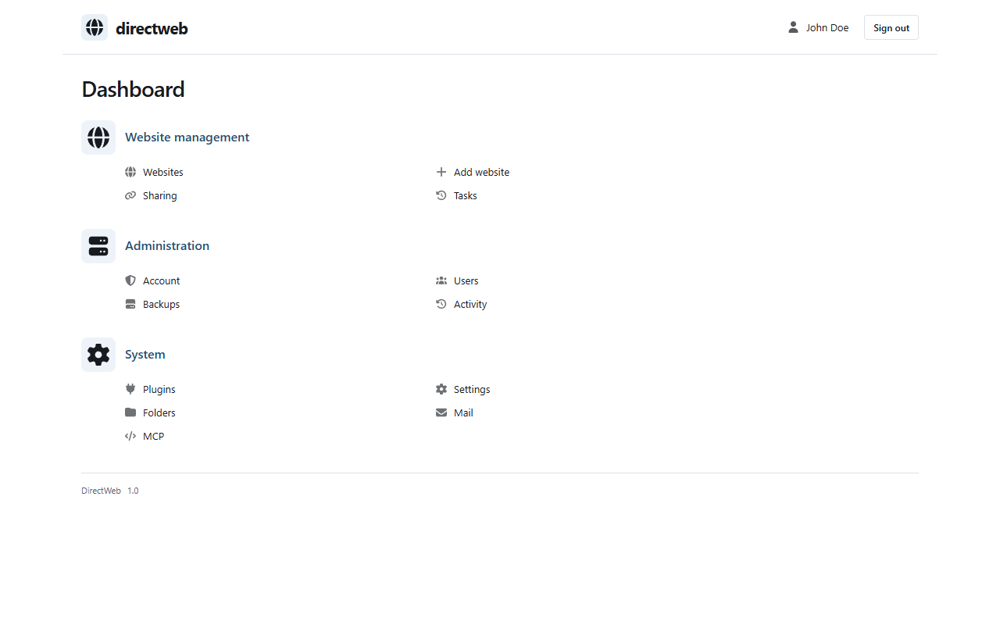
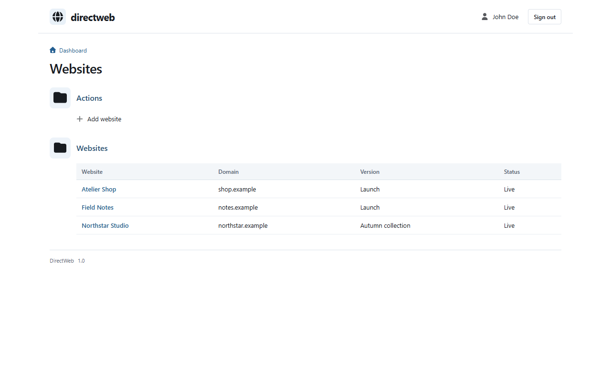
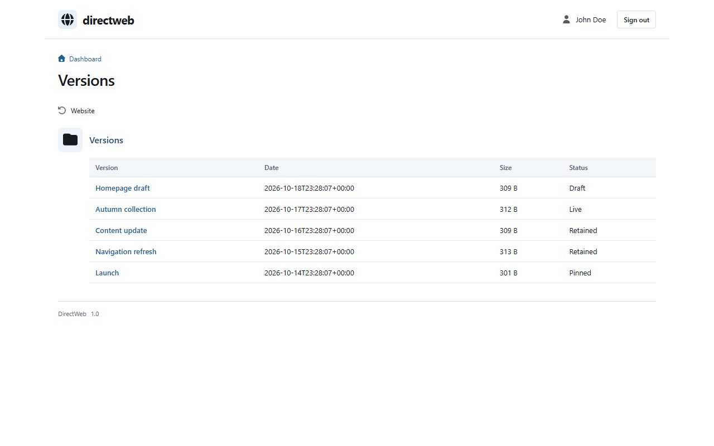
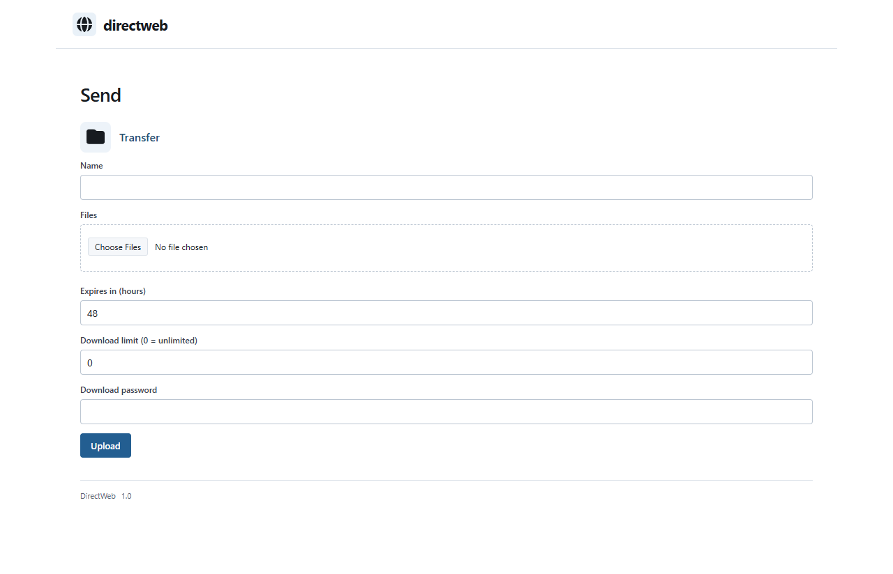

# DirectWeb

**A lightweight, extensible platform for hosting and managing websites through a simple, unified interface.**



Manage websites, users and services from one place. Built with [LUMUI](https://github.com/Open-System-Query/lumui), with plugins for file sharing, mail, MCP and more. Available in 21 languages.

## Screenshots

| Websites | Versions | File sharing |
| --- | --- | --- |
| [](Docs/Images/directweb-websites.png) | [](Docs/Images/directweb-versions.png) | [](Docs/Images/directweb-sharing.png) |

## Repository

- [`Source/Shared`](Source/Shared): core, plugins, translations and assets
- [`Source/Webserver`](Source/Webserver): webserver integration
- [`Source/WordPress`](Source/WordPress): WordPress integration
- [`Docs`](Docs): screenshots

## Setup

Build the upload packages with PHP 8.1+ and ZIP support:

```sh
php Build.php
```

Packages are created in `Build/Packages`.

- **Webserver:** extract `directweb-webserver.zip` into a domain root or subfolder, including `.htaccess`. Open its URL to complete setup.
- **WordPress:** upload `directweb-wordpress.zip` through **Plugins → Add New**, activate it and open **DirectWeb**.

Requires PHP 8.1+, PDO SQLite, SQLite3, ZIP, Sodium, Mbstring, OpenSSL, Fileinfo and Argon2id. The webserver edition uses HTTPS and Apache rewrite rules; scheduled jobs require a hosting cron task. WordPress uses its own cron.

Upload static websites as ZIP files containing `index.html` or `index.htm`. Additional services can be enabled under **Plugins**.

## License

[MIT](LICENSE) · [Open System Query](https://opensystemquery.nl/). Bundled dependencies retain their [own licenses](Source/Shared/licenses). Public packages use Font Awesome Free.
